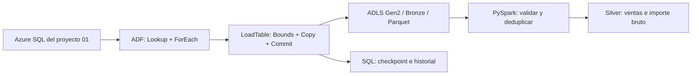

# Retail Andes

## Alcance

Ingesta SQL → Azure Data Factory → ADLS Gen2 en Parquet, con metadatos, cargas completas e incrementales y transformación Silver con PySpark. Usa datos de ejemplo y ventas ficticias.



## Componentes

- Grupo independiente `rg-leadutp-04-dev`, región Brazil South.
- SQL existente del proyecto 01: `sqldb-leadutp`.
- Tablas completas: `SalesLT.Customer` y `SalesLT.Product`.
- Tabla incremental: `retail.Sales`, con `UpdatedAt` UTC.
- Metadatos: `etl.LoadConfig`; historial confirmado: `etl.LoadHistory`.
- Procedimientos: `etl.ListLoads`, `etl.GetBounds`, `etl.CommitLoad`.
- Storage HNS con contenedores privados Bronze y Silver, claves compartidas deshabilitadas.
- ADF usa identidad administrada, permisos SQL limitados y escritura en Bronze. El usuario tiene permiso sobre el lake para descargar y comprobar datos.
- Sin triggers recurrentes ni clúster Databricks permanente.

## Desplegar e inicializar

Desde la raíz LeadUTP:

```powershell
./04-retail-andes/scripts/Deploy.ps1 -Mode Validate
./04-retail-andes/scripts/Deploy.ps1 -Mode WhatIf
./04-retail-andes/scripts/Deploy.ps1 -Mode Deploy
./04-retail-andes/scripts/Invoke-Sql.ps1 -Action Initialize
```

Initialize crea los esquemas y ventas ficticias sin modificar AdventureWorksLT. Repetirlo no reinicia checkpoints ni resembra la tabla. Si SQL está pausado, la primera conexión puede iniciar su reanudación y fallar: repetir cuando esté disponible.

`scripts/build_pipelines.py` genera los JSON ADF versionables de `adf/`; Bicep los publica. Cambiar las definiciones solo entre ejecuciones.

## Prueba completa e incremental

```powershell
./04-retail-andes/scripts/Run-Pipeline.ps1
./04-retail-andes/scripts/Invoke-Sql.ps1 -Action DemoChanges
./04-retail-andes/scripts/Run-Pipeline.ps1 -OnlyTable retail.Sales
./04-retail-andes/scripts/Run-Pipeline.ps1 -OnlyTable retail.Sales
./04-retail-andes/scripts/Invoke-Sql.ps1 -Action Inspect
./04-retail-andes/scripts/Invoke-Sql.ps1 -Action Verify
```

En un laboratorio nuevo, la primera carga debe copiar tres ventas; DemoChanges actualiza una e inserta otra, una sola vez. La siguiente carga debe copiar dos y la repetición sin cambios debe copiar cero. DemoChanges es una prueba idempotente; no genera cambios nuevos al repetirse.

Verify comprueba la secuencia exacta de tres ejecuciones 3/2/0, el checkpoint sin cambios en la tercera y la idempotencia de repetir Commit del primer run. Es una prueba del laboratorio nuevo; después de añadir más ejecuciones se deberá adaptar esa expectativa.

Para cada tabla, Bounds captura un límite superior antes de Copy. El filtro incremental es `(LastWatermark, UpperWatermark]`. Solo Commit, dependiente de Copy exitoso, avanza el checkpoint y registra el historial. Las ejecuciones del padre y del hijo tienen concurrencia 1; Commit comprueba que el checkpoint no haya cambiado y evita duplicar su registro en reintentos.

Bronze separa cada tabla y ejecución: `bronze/<schema>/<table>/run_id=<GUID>/data.parquet`. Usar nombre determinista permite reemplazar el mismo archivo en un reintento. Los archivos de una ejecución fallida no deben consumirse; solo usar run IDs confirmados en el historial y ejecuciones con estado Succeeded.

## Seguridad de las conexiones

Invoke-Sql autoriza temporalmente una IP individual del PC y la retira al finalizar. Run-Pipeline agrega temporalmente la excepción SQL para servicios Azure (dirección especial 0.0.0.0) y la retira al finalizar. Esa excepción abarca servicios de otras suscripciones Azure, pero no omite autenticación ni permisos SQL. Es una simplificación del laboratorio; en producción se debe diseñar conectividad privada o una salida con IP controlada.

La ingesta principal no usa contraseñas SQL ni claves de Storage. La ampliación integra Key Vault con identidad de ADF para leer una política de validación y demuestra además una credencial real en un linked service: SAS de delegación de usuario, solo lectura/listado de `credentials-demo`, con vencimiento de una hora. No habilita claves compartidas ni modifica la autenticación Entra de SQL.

## Comprobar Parquet y Silver

```powershell
./04-retail-andes/scripts/Inspect-Run.ps1 -RunId GUID
./04-retail-andes/scripts/Download-Bronze.ps1 -RunId GUID
. ./scripts/Enter-DevEnvironment.ps1
python -m venv ./04-retail-andes/.venv
& ./04-retail-andes/.venv/Scripts/python.exe -m pip install -r ./04-retail-andes/requirements.txt
& ./04-retail-andes/.venv/Scripts/python.exe ./04-retail-andes/scripts/verify_parquet.py --run-id GUID
```

Descargar los run IDs de la primera y segunda carga confirmada. La transformación local usa la imagen oficial Spark 4.0.1 con Python:

```powershell
./04-retail-andes/scripts/Build-Silver.ps1 -RunIds GUID_PRIMERA_CARGA,GUID_SEGUNDA_CARGA
```

Lee los Parquet reales, conserva la versión más reciente por SaleId y calcula GrossAmount con decimal. Para la demostración completa se esperan cuatro ventas y PEN 472.20 de importe bruto. Escribe en `.local/silver` y deja métricas en `.local/silver-result.json`.

Publicar los archivos Silver calculados en ADLS:

```powershell
./04-retail-andes/scripts/Publish-Silver.ps1 -RunId GUID_SEGUNDA_CARGA
```

La publicación usa tu identidad Azure CLI; no necesita claves de Storage.

`notebooks/RetailAndes.py` está importado en `/Shared/RetailAndes/BronzeToSilver` del workspace `dbw-retail-andes`. Usa Unity Catalog, Access Connector y una identidad administrada de usuario para leer Bronze y escribir Delta en `silver/SalesDelta`. El clúster dedicado de un nodo está asignado a la identidad de ADF. Lectura/escritura se limita a Bronze/Silver; el permiso Storage Blob Delegator a nivel de cuenta permite emitir las credenciales temporales requeridas por UC. El resultado exacto de la ejecución remota y su estado de energía se registran en RESULTADO.md.

## Ampliación remota

Los scripts están limitados a los nombres del laboratorio existente. Desde la raíz:

```powershell
./04-retail-andes/scripts/Initialize-Databricks.ps1
./04-retail-andes/scripts/Publish-RemotePipeline.ps1
./04-retail-andes/scripts/Inspect-Run.ps1 -RunId GUID_DEVUELTO
./04-retail-andes/scripts/Inspect-Databricks.ps1
# Detener al finalizar y comprobar que termine en TERMINATED
./04-retail-andes/scripts/Inspect-Databricks.ps1 -Stop
```

`Publish-RemotePipeline.ps1 -PolicyOnly` prueba únicamente ADF → Key Vault. Sin ese modificador publica y ejecuta `Retail_DatabricksSilver`: lee `silver-expected-sales` de Key Vault, lo pasa al notebook y exige cuatro ventas con importe PEN 472.20 tras releer Delta. Usa los dos run IDs confirmados de la demostración, no cualquier archivo que aparezca en Bronze. No deja triggers recurrentes.

`Test-KeyVaultCredential.ps1` renueva una SAS acotada, la guarda por HTTPS en Key Vault sin imprimirla y dispara `Retail_ValidateKeyVaultCredential`. Verificar con Inspect-Run y los metadatos de la actividad `ReadPrivateBlob`: archivo existente y tamaño positivo. Al vencer la SAS, repetir el script para renovar antes de otro ensayo. La identidad de ADF recibe la credencial desde el linked service de Key Vault; no está en el JSON del pipeline.

La primera configuración de UC necesitó una identidad Entra temporal por una inconsistencia de vinculación de la cuenta MSA. Las aplicaciones temporales se retiraron y sus principales de Databricks se deshabilitaron; los objetos UC quedaron a cargo del usuario. `Bootstrap-Databricks.ps1` documenta ese mecanismo de inicialización; no es necesario para las ejecuciones habituales una vez configurado el acceso. No contiene credenciales persistentes.

## Límites y costos

ADF factura actividades y movimiento de datos; Storage factura almacenamiento y operaciones. Databricks agrega DBU y cómputo; su grupo administrado `rg-retail-databricks-managed` incluye NAT Gateway e IP, que pueden cobrar aun con el clúster detenido. Además del presupuesto del grupo 04, `budget-retail-andes-total` cubre por filtro ambos grupos, con importe mensual 10 y avisos 80%/100%. Ninguno detiene servicios. No se verificó el crédito restante Students. SQL conserva su oferta gratuita con pausa al agotar el límite. El clúster tiene terminación por inactividad a diez minutos; comprobar su detención al finalizar cada prueba. La ejecución remota final aprobó y quedó TERMINATED; ver RESULTADO.md.

El watermark de tiempo es didáctico: exige que UpdatedAt cambie en cada modificación y no detecta eliminaciones. No garantiza captura completa con transacciones concurrentes tardías o marcas retroactivas; para producción evaluar CDC/Change Tracking y una estrategia de consistencia y borrados.

## Limpieza

Eliminar el grupo 04 retira ADF y el lake, incluyendo archivos Bronze/Silver. No elimina la base del grupo 01. Los objetos retail/etl y el usuario SQL de ADF permanecen en la base compartida hasta retirarlos explícitamente. Antes de eliminar, revisar dependencias y conservar las evidencias necesarias.

## Referencias

- [Conector SQL y managed identity](https://learn.microsoft.com/en-us/azure/data-factory/connector-azure-sql-database)
- [ADLS Gen2 y managed identity](https://learn.microsoft.com/en-us/azure/data-factory/connector-azure-data-lake-storage)
- [Cargas incrementales por watermark](https://learn.microsoft.com/en-us/azure/data-factory/tutorial-incremental-copy-overview)
