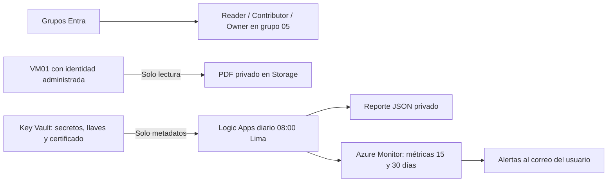

# Identidades, Key Vault y monitoreo

## Descripción de lo realizado

**Objetivo:** conceder permisos mínimos, acceder a datos sin claves y detectar vencimientos.

Se crearon grupos de Entra con Reader, Contributor y Owner limitados al grupo del laboratorio, además de un usuario lector deshabilitado. Se preparó un Key Vault con secretos, llaves y certificado sintéticos con diferentes fechas de expiración.

VM01 del proyecto 03 recibió una identidad administrada y permiso de lectura sobre un contenedor privado. La VM descargó el PDF y verificó su hash; un intento de escritura fue rechazado con 403.

Una Logic App consulta vencimientos diariamente a las 08:00 de Lima, guarda un reporte y publica métricas. Azure Monitor activó dos alertas para objetos a 15 y 30 días. El usuario informó que no recibió los correos: destinatario y enlaces están configurados, pero la API de prueba rechazó la oferta Students. La verificación del correo y la entrega real siguen pendientes. Authenticator fue confirmado por el usuario; eso no demuestra una auditoría de todas las políticas MFA del tenant.

**Uso:** `05-identidades-keyvault-monitoreo/scripts/Inspect-Monitor.ps1` y `Test-Monitor.ps1`. Los correos no son mensajes diarios individuales por secreto: las alertas son agregadas y con estado.

## Resultado

Laboratorio de Entra ID, RBAC, Key Vault, identidad administrada de VM y auditoría de vencimientos con Logic Apps y Azure Monitor. Consultar `RESULTADO.md` para evidencias y estado final.

## Diseño



## Identidades y alcance

- Grupo base: `GRP_bootcamp_LEAD_UTP`, rol Reader.
- Grupos adicionales con sufijos `_Contributor` y `_Owner`, sin miembros.
- Los tres roles se asignan exclusivamente a `rg-leadutp-05-dev`.
- Se creó un usuario `lab.reader.leadutp` en el dominio del tenant, deshabilitado y miembro del grupo lector. La contraseña aleatoria no se guardó ni se imprimió; para habilitar un ejercicio de inicio de sesión habría que resetearla y completar el registro correspondiente.
- El usuario actual tiene permisos de directorio suficientes para crear estos objetos. Esos permisos son distintos de Owner de Azure.
- El usuario confirmó que Microsoft Authenticator ya está vinculado a su cuenta. No se presenta esa confirmación como una comprobación automática de todas las políticas MFA del tenant.

## Recursos y permisos

- Grupo `rg-leadutp-05-dev`, Brazil South.
- Key Vault con RBAC y borrado suave de 7 días.
- Storage privado con contenedores `documents` y `reports`; claves compartidas y acceso anónimo deshabilitados.
- VM01 se reutiliza desde el grupo 03. Se habilita su identidad SystemAssigned y recibe Storage Blob Data Reader solo sobre `documents`.
- Logic Apps recibe Key Vault Reader (metadatos), Monitoring Metrics Publisher en el vault y Storage Blob Data Contributor solo en `reports`.
- El operador recibe Key Vault Administrator en este vault y permiso de datos para administrar el Storage del laboratorio.
- Action Group de correo y dos reglas de alertas, para intervalos hasta 15 días y de más de 15 a 30 días.

## Preparación y despliegue

Desde la raíz LeadUTP, con Azure CLI autenticada y los proveedores KeyVault, Logic, Insights y Storage registrados:

```powershell
./05-identidades-keyvault-monitoreo/scripts/Setup-Entra.ps1
./05-identidades-keyvault-monitoreo/scripts/Deploy.ps1 -Mode Validate
./05-identidades-keyvault-monitoreo/scripts/Deploy.ps1 -Mode WhatIf
./05-identidades-keyvault-monitoreo/scripts/Deploy.ps1 -Mode Deploy
```

La implementación depende de VM01 del proyecto 03. La identidad debe volver a comprobarse si se elimina o recrea esa VM. Deploy crea el flujo deshabilitado para poder sembrar y validar los datos antes de habilitar la programación. Un redepliegue también lo deshabilita; ejecutar Enable-Monitor al terminar.

## Datos de demostración

El PDF final está en `output/pdf/documento-demo.pdf`. Se creó con ReportLab, se comprobó su texto y se renderizó para revisión visual. Los scripts generadores usan las dependencias de `requirements.txt`; durante la preparación se ejecutaron con el Python incluido en el entorno de trabajo.

```powershell
python ./05-identidades-keyvault-monitoreo/scripts/create_demo_certificate.py
./05-identidades-keyvault-monitoreo/scripts/Initialize-Data.ps1
```

Initialize crea secretos sintéticos a 10/25/90 días, una llave RSA-2048 a 20 días, una EC P-256 a 90 días e importa un certificado autofirmado de 12 días. El PFX de prueba queda en `.local`, excluido de Git; no es un certificado para producción. Los valores de secretos, claves privadas y tokens no se imprimen.

## Prueba de VM y Storage

```powershell
./05-identidades-keyvault-monitoreo/scripts/Test-VMStorage.ps1
```

Inicia únicamente VM01, obtiene un token temporal desde IMDS dentro de la VM, lee el PDF por HTTPS y compara SHA-256 con el original. También comprueba que un intento de escribir otro blob sea denegado con 403. En finally solicita la desasignación de VM01. Verificar el estado final con `az vm list -g rg-leadutp-03-dev -d -o table`.

## Auditoría y correo

```powershell
./05-identidades-keyvault-monitoreo/scripts/Enable-Monitor.ps1 -RunNow
./05-identidades-keyvault-monitoreo/scripts/Inspect-Monitor.ps1
./05-identidades-keyvault-monitoreo/scripts/Test-Monitor.ps1
```

El flujo diario de las 08:00 America/Lima enumera páginas de secretos, certificados y llaves. Solo lee metadatos; no solicita valores de secretos. Excluye objetos deshabilitados, sin fecha de expiración y llaves/secretos administrados por certificados, para no contarlos dos veces. Incluye objetos ya vencidos en el intervalo urgente.

Escribe `reports/keyvault-expiry/latest.json` con IDs, fechas y días restantes. Publica dos métricas bajo `LeadUTP.KeyVault`: Due15Days y Due30Days. Azure Monitor evalúa los conteos y notifica mediante el Action Group al correo indicado por el usuario.

Las alertas son agregadas y con estado: notifican al activarse/resolverse, no envían un recordatorio individual por cada objeto ni un correo diario si la condición permanece igual. La revisión diaria actualiza el reporte. Para producción, un esquema de notificación por objeto y umbral necesitaría seguimiento y deduplicación adicionales. Las reglas no sustituyen rotación de claves ni renovación de certificados.

Test-Monitor espera los cuatro vencimientos de demostración (2/2), comprueba las métricas reales y que ambas reglas estén Fired. La primera publicación puede tardar unos minutos en aparecer. No confirma entrega o lectura en el buzón.

## Costos y retiro

Presupuesto de USD 10/mes con avisos al 80% y 100%. No detiene consumo. Logic Apps, Key Vault, reglas de alerta y Storage pueden generar cargos; no se verificó el crédito restante Students. La VM se usa solo durante la prueba; sus discos e IP públicas del proyecto 03 mantienen cargos mientras existan.

Eliminar el grupo 05 retira recursos y las asignaciones RBAC de ese alcance, pero no elimina grupos/usuario Entra ni VM01 del grupo 03. Retirar esos objetos debe hacerse por sus IDs y después de revisar sus miembros y dependencias. Key Vault conserva el borrado suave; no se purga automáticamente.

## Referencias

- [RBAC de Key Vault](https://learn.microsoft.com/en-us/azure/key-vault/general/rbac-guide)
- [Identidad administrada de VM Linux](https://learn.microsoft.com/en-us/entra/identity/managed-identities-azure-resources/tutorial-linux-managed-identities-vm-access)
- [Logic Apps con managed identity](https://learn.microsoft.com/en-us/azure/logic-apps/authenticate-with-managed-identity)
- [Métricas personalizadas de Azure Monitor](https://learn.microsoft.com/en-us/azure/azure-monitor/metrics/metrics-store-custom-rest-api)

## Configuración local de correo

Los scripts reciben el destinatario con `-ContactEmail`, `AZURE_ALERT_EMAIL` o `.local/settings.json` (`alertEmail`). No se publica el correo personal como valor predeterminado del código. La recepción de alertas en el buzón sigue pendiente de confirmación.
