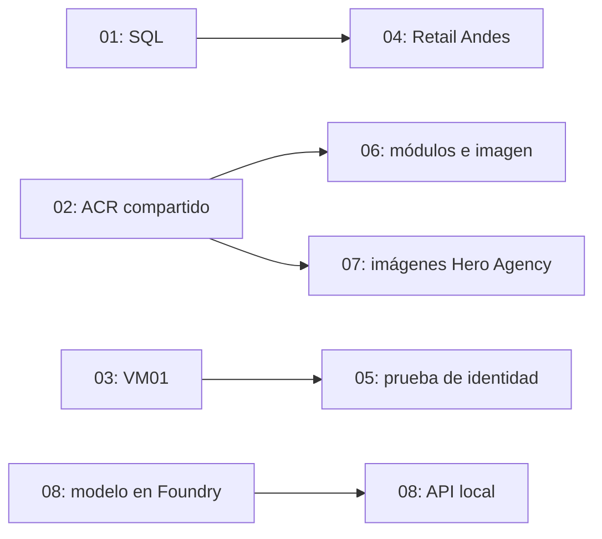

# Guía de los proyectos LEAD UTP

Este portafolio reúne ocho laboratorios de Azure y desarrollo de aplicaciones. Cada proyecto tiene su propia carpeta, código, infraestructura, scripts de operación y un `RESULTADO.md` con las comprobaciones realizadas. Los datos comerciales, votos, clientes y campañas son de demostración.

La solución combina trabajo local con recursos reales de Azure. Una plantilla que compila no demuestra que un servicio funcione: los informes distinguen preparación, despliegue y prueba de funcionamiento. Los nombres y resultados corresponden al laboratorio de octubre de 2026; el estado vivo puede cambiar después.

## 01. Configuración inicial, costos y Azure SQL

**Objetivo:** preparar una suscripción, organizar sus recursos y crear una base de datos accesible con una identidad de Microsoft Entra.

Se creó el grupo `rg-leadutp-01-dev`, un presupuesto mensual de USD 10 con alertas al 80% y 100%, y una base Azure SQL con la muestra AdventureWorksLT. La oferta gratuita está habilitada y configurada para pausar al agotar su límite. La autenticación usa Azure CLI y Entra, sin contraseñas SQL en archivos.

La conexión cifrada y consultas reales verificaron clientes y productos. Las reglas temporales de firewall se retiraron al terminar. La base también sirve de origen para Retail Andes.

**Aprendizaje:** grupos de recursos, presupuestos, Azure CLI, Bicep, autenticación y consultas SQL. Para repetir la verificación, consultar `01-configuracion-costos-sql/scripts/Verify-Sql.ps1` y el README de esa carpeta.

## 02. Web .NET, API Python y contenedores

**Objetivo:** construir y desplegar una aplicación distribuida sencilla.

Una web .NET 10 sirve el catálogo y consulta una API FastAPI con tres productos ficticios en PEN. Docker Compose permite ejecutar ambos componentes localmente. En Azure, la web usa App Service F1 y la API usa Container Apps, que descarga su imagen desde un ACR privado mediante identidad administrada. Se configuró escalado mínimo cero para la API.

Se añadió una VM Windows Server 2022 en Central US, sin IP pública ni puertos entrantes abiertos. Su sistema operativo se comprobó con Run Command y la VM se desasignó después de la prueba. Las VM Linux se cubren en el proyecto 03.

La publicación desde GitHub Actions compila .NET, autentica mediante OIDC, despliega App Service y comprueba salud y catálogo. Su identidad tiene permiso Website Contributor solo sobre esa web. No utiliza un secreto de publicación permanente.

**Uso:** `02-computo-web-contenedores/scripts/Test-Local.ps1` y `Test-Azure.ps1`. Local: web 18080, API 18000. Azure: `https://web-leadutp02-jmas5j6rizpu4.azurewebsites.net`.

**Pendiente externo:** no hay dominio propio. Se mantiene el dominio de Azure; un dominio personalizado exige disponer del dominio, controlar DNS y comprobar compatibilidad del plan.

## 03. Redes virtuales y seguridad

**Objetivo:** entender la conectividad entre servidores y restringirla con reglas explícitas.

Se desplegó una VNet con dos subredes y dos VM Ubuntu 24.04 ARM64 en Central US. Cada subred tiene un NSG. VM01 expone el servicio de demostración y se comunica con VM02 por IP privada. SSH queda limitado y se bloquea el tráfico no autorizado entre subredes.

Las pruebas verificaron HTTP real entre VM y desde el PC, acceso SSH con clave, bloqueos TCP y decisiones Allow/Deny con Network Watcher. Que el puerto 443 esté permitido en una regla no equivale a haber instalado y probado HTTPS en la VM.

**Uso:** `03-redes-seguridad/scripts/Test-Network.ps1`; revisar antes `Set-PowerState.ps1` y el README. Las VM quedaron desasignadas; volver a ejecutar las pruebas puede requerir iniciarlas y genera consumo.

## 04. Retail Andes: ingesta y transformación

**Objetivo:** convertir datos operacionales en un lago de datos con cargas controladas y una capa Silver.

Azure SQL contiene clientes, productos y ventas sintéticas. ADF consulta una tabla de metadatos con Lookup, recorre las cargas con ForEach y ejecuta Copy. Las tablas completas se extraen de nuevo; las incrementales usan una ventana de watermark. Solo una copia exitosa permite confirmar el nuevo checkpoint y registrar su historial.

Bronze almacena Parquet por tabla y run ID. Las ejecuciones verificadas copiaron 3 ventas inicialmente, 2 tras los cambios y 0 al repetir sin cambios. PySpark consolidó cuatro ventas por PEN 472.20, conservando la versión reciente de cada venta. Ese resultado local fue publicado y leído de nuevo desde ADLS.

La ampliación remota incorpora workspace Databricks Premium, Unity Catalog, Access Connector con identidad administrada y un notebook que lee Bronze y escribe Delta en `SalesDelta`. ADF ejecutó el notebook y verificó la relectura de cuatro ventas por PEN 472.20. Key Vault aporta la política de validación y una SAS de demostración de solo lectura con vencimiento de una hora: otro linked service recuperó esa credencial y permitió a ADF comprobar un archivo privado real de 68 bytes. El clúster quedó TERMINATED. El detalle está en `04-retail-andes/RESULTADO.md`.

**Uso:** los scripts `Run-Pipeline.ps1`, `Inspect-Run.ps1`, `Build-Silver.ps1` y `Publish-Silver.ps1` cubren el flujo ya probado. Los de Databricks amplían la ejecución remota. No repetir Initialize esperando reiniciar el historial: está diseñado para ser idempotente.

**Límite didáctico:** el watermark no captura borrados ni garantiza consistencia con escritores concurrentes; una solución productiva requiere revisar CDC/Change Tracking y transacciones tardías.

## 05. Identidades, Key Vault y alertas

**Objetivo:** conceder permisos mínimos, acceder a datos sin claves y detectar vencimientos.

Se crearon grupos de Entra con Reader, Contributor y Owner limitados al grupo del laboratorio, además de un usuario lector deshabilitado. Se preparó un Key Vault con secretos, llaves y certificado sintéticos con diferentes fechas de expiración.

VM01 del proyecto 03 recibió una identidad administrada y permiso de lectura sobre un contenedor privado. La VM descargó el PDF y verificó su hash; un intento de escritura fue rechazado con 403.

Una Logic App consulta vencimientos diariamente a las 08:00 de Lima, guarda un reporte y publica métricas. Azure Monitor activó dos alertas para objetos a 15 y 30 días. El usuario informó que no recibió los correos: destinatario y enlaces están configurados, pero la API de prueba rechazó la oferta Students. La verificación del correo y la entrega real siguen pendientes. Authenticator fue confirmado por el usuario; eso no demuestra una auditoría de todas las políticas MFA del tenant.

**Uso:** `05-identidades-keyvault-monitoreo/scripts/Inspect-Monitor.ps1` y `Test-Monitor.ps1`. Los correos no son mensajes diarios individuales por secreto: las alertas son agregadas y con estado.

## 06. Infraestructura como código y observabilidad

**Objetivo:** desplegar una plataforma repetible y verificarla con CI/CD.

Bicep organiza recursos, módulos propios versionados en el ACR y un módulo AVM para Log Analytics. Despliega Container Apps, identidad, Key Vault, Application Insights, workspace y presupuesto. GitHub Actions usa OIDC para compilar, revisar what-if, desplegar y verificar la API.

La ampliación incorpora una imagen propia instrumentada con OpenTelemetry. Al iniciar, la API lee `catalog-label` de Key Vault mediante su identidad administrada; no devuelve el valor del secreto. Las peticiones y trazas llegan a Application Insights y los registros de consola a Log Analytics. Se fijó la imagen por digest para evitar cambios accidentales de etiqueta.

**Uso:** `06-infraestructura-bicep/scripts/Test-Azure.ps1`, `Inspect-Logs.ps1` e `Inspect-Telemetry.ps1`. La API es `https://ca-lead06-api.kindwave-4a2cdf0a.brazilsouth.azurecontainerapps.io`.

La integración de logs del entorno Express usa internamente una clave de workspace resuelta por ARM; las aplicaciones se autentican con identidad administrada para Key Vault. No se debe describir toda la plataforma como completamente libre de claves.

## 07. Hero Agency: entrega continua

**Objetivo:** llevar una demo de votación desde código hasta staging y producción con controles de ramas.

La aplicación usa Node.js 24 y Express 5. Localmente guarda votos en memoria; en Azure los conserva en Table Storage. Staging y producción usan tablas e identidades diferentes. Las cookies tienen identificadores opacos y solo su hash se guarda como clave. Repetir un voto es idempotente y cambiarlo devuelve 409. No es un sistema electoral: borrar cookies permite volver a votar.

Azure Pipelines ejecuta cinco etapas: Build, Test, Policies, Staging y Production. La promoción usa el mismo digest de imagen y verifica disponibilidad. Se comprobó que los votos persistieran tras el despliegue. La validación automática del PR también aprobó, sin desplegar desde la rama del PR.

**Uso:** `07-hero-agency/scripts/Test-Local.ps1`, `Test-Azure.ps1` e `Inspect-Pipeline.ps1`. Local: puerto 18070. La opción `-Vote` de la prueba remota agrega votos ficticios.

**Pendiente humano:** aprobar y fusionar el PR de Azure Repos exige otro revisor. La política excluye al autor; no se realizó bypass ni se simuló una aprobación.

## 08. Banco ABC: campañas con IA

**Objetivo:** seleccionar campañas afines y generar comunicaciones con una guía de marca recuperada de PDF.

FastAPI expone perfiles ficticios y un endpoint de generación. LangGraph encadena selección, recuperación de conocimiento, redacción y validación. El matching usa reglas explicables de intereses y categorías de consumo. El RAG extrae texto del PDF y recupera fragmentos por coincidencia léxica, con página y fuente; no necesita un servicio vectorial.

El modo local usa plantillas. El modo Azure llama realmente al despliegue `banco-abc-texto` de gpt-4.1-mini en Foundry y exige salida JSON estructurada. Produce asunto, preheader, cuerpo, SMS, pop-up y prompt de imagen en inglés para cada campaña. Las condiciones se toman del catálogo. Los prompts no se envían a generadores de imágenes.

Once pruebas verificaron el flujo y sus restricciones; también se realizaron llamadas reales al modelo. Los perfiles incluyen DNI ficticio, rango de edad, estado civil e hijos sintéticos. El matching incorpora una afinidad educativa limitada a etapa de estudio o familiar; DNI y estado civil quedan excluidos del ranking y del modelo. Los resultados son `needs_human_review`. No se envían mensajes ni se toman decisiones de crédito.

**Uso:** `08-campanas-ia-banco/scripts/Start-Local.ps1`, abrir `http://localhost:18090/docs`. Para consumo del modelo remoto, reiniciar con `-Azure` y usar `mode: "azure"`. La API permanece local, sin autenticación para publicación pública.

## Cómo recorrer el portafolio

1. Leer esta guía y el README del proyecto elegido.
2. Revisar su `RESULTADO.md` para conocer pruebas, recursos y límites.
3. Activar herramientas con `. ./scripts/Enter-DevEnvironment.ps1`.
4. Verificar la suscripción seleccionada con `az account show`.
5. Ejecutar primero consultas o pruebas; revisar cada script antes de aplicar cambios o agregar datos.

Cada carpeta mantiene su entorno y dependencias. `.local`, `.venv`, claves, certificados privados y configuraciones personales se excluyen de Git. Un ejemplo de configuración no sustituye el inicio de sesión de Azure.

## Dependencias entre proyectos

Las carpetas están separadas, pero algunos recursos se reutilizan. No eliminar el ACR 02 mientras 06/07 lo usen, ni SQL 01 mientras 04 lo necesite. Antes de retirar un grupo, revisar recursos compartidos, identidades, permisos y copias de evidencia.

## Costos y cierre

Los presupuestos generan avisos; no apagan recursos ni garantizan un límite global. El usuario observó saldo sin cambios, pero no se ha confirmado su importe actual ni vencimiento. La consulta mensual de Cost Management respondió sin filas de consumo, tras una limitación temporal 429; una respuesta sin filas no demuestra gasto cero. Se confirmó oferta AzureForStudents y spendingLimit On. Discos e IP públicas pueden seguir cobrando con VM desasignadas. ACR, Storage, monitorización, Logic Apps, ADF, Databricks y tokens de IA pueden generar cargos. [Microsoft explica los retrasos y límites de los datos de costos](https://learn.microsoft.com/en-us/azure/cost-management-billing/costs/understand-cost-mgt-data).

Los trabajos Databricks deben terminarse al finalizar: la terminación automática es una protección adicional, no reemplaza comprobar el estado. El workspace agrega recursos administrados, incluido NAT Gateway, con posibles costos incluso sin clúster activo. Se añadió un presupuesto filtrado a ambos grupos de Retail Andes. Consultar el crédito en Educación y retirar únicamente recursos que ya no se necesiten; las APIs de Cost Management pueden tener limitaciones de oferta y disponibilidad de datos.

El cierre completo también depende de un dominio propio si se desea ese ejercicio, la confirmación del correo de alertas y la revisión humana del PR. Los informes de cada carpeta son la fuente de verdad para el estado técnico de cada comprobación.
